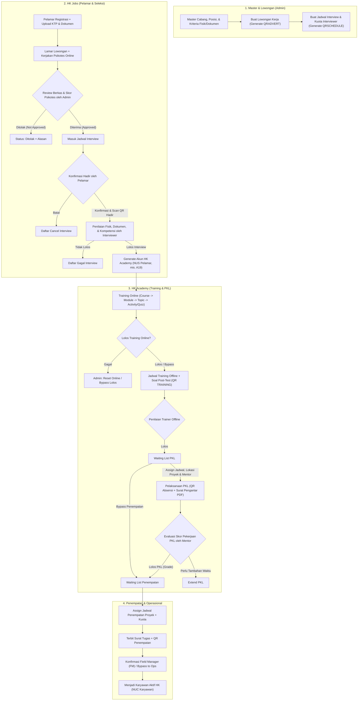

# Cetak Biru (System Blueprint) HKJobs & HK Academy

Dokumen ini adalah hasil rekayasa balik (*reverse-engineering*) langsung dari sistem produksi **`https://ops.hk-indonesia.id/hkjobs/`** menggunakan akun Super Admin (`62001` — **DIMAS ALFA PRATAMA**) serta pengujian lintas peran (`62002` Interviewer & `62003` Trainer).

---

## 1. Gambaran Umum Sistem

Website **`ops.hk-indonesia.id/hkjobs`** adalah **Web Backoffice / Admin CMS** (berbasis CodeIgniter 3, Bootstrap 4, dan Server-Side DataTables) milik **Hygiene Kleen (PT Peduli Cepat Internasional / Carefast)** yang mengelola siklus hidup tenaga kerja dari hulu ke hilir:

1. **Umum & Master Organisasi**: Kantor cabang, lokasi interview, posisi jabatan, standar kriteria fisik/dokumen per posisi, data karyawan eksisting, dan proyek klien (*Manpower Planning*).
2. **HK Jobs (Rekrutmen & Seleksi)**: Pendaftaran pelamar (*New Comer* & *Existing*), publikasi lowongan kerja (dengan QR Code), psikotes online, penjadwalan interview multi-interviewer, dan penilaian kelulusan interview.
3. **HK Academy (Onboarding, Pelatihan, PKL, & Penempatan)**: Konversi pelamar lolos menjadi peserta *Academy* (mendapat **NUS Pelamar**), materi *e-learning* berjenjang (*Course → Module → Topic → Activity*), ujian *Training Online* & *Training Offline*, *Praktik Kerja Lapangan* (PKL) bersama Mentor proyek, hingga penerbitan **Surat Tugas Penempatan** yang divalidasi oleh *Field Manager* (FM) sebelum masuk ke sistem operasional (**NUC Karyawan**).

---

## 2. Peta Aktor & Hak Akses (7 Peran)

Berdasarkan tabel `admin_master`, `applicant`, `login_apps`, `mentor`, dan `fieldmanager`, terdapat **7 peran pengguna** di dalam ekosistem ini:

| # | Peran (Role) | Identitas Login | Kanal Saat Ini | Tugas Utama |
|---|---|---|---|---|
| 1 | **Super Admin / Admin Cabang** | `phone` (`62001`) + Password | Web (`hkjobs`) | Mengelola seluruh master data, lowongan, psikotes, menyetujui berkas pelamar, membuat jadwal interview/training/PKL/penempatan, & melakukan *bypass* status. |
| 2 | **Supervisor** | `phone` + Password | Web (`hkjobs`) | Monitoring laporan rekrutmen cabang, *approval* lowongan, dan pengawasan *pipeline*. |
| 3 | **Interviewer** | `phone` (`62002`) + Password | Web (`hkjobs/interviewer/{id}`) / Mobile | Melihat jadwal interview yang ditugaskan, memindai/cek kehadiran QR kandidat, memverifikasi fisik & dokumen asli, serta menilai kelulusan interview. |
| 4 | **Trainer** | `phone` (`62003`) + Password | Web (`hkjobs/training`) / Mobile | Mengelola kelas *Training Offline*, absensi QR peserta, dan memberikan nilai/status kelulusan *Training Offline*. |
| 5 | **Pelamar (Candidate)** | `phone_applicant` / Email + Password | Aplikasi Mobile (HK Jobs) | Registrasi profil & unggah 12 dokumen, cari/lamar lowongan (atau scan QR Loker), kerjakan Psikotes, konfirmasi kehadiran interview, & scan QR hadir interview. |
| 6 | **Peserta Academy (Trainee)** | `nus_pelamar` (mis. `A1`, `A19`) + Password | Aplikasi Mobile (HK Academy) | Login pasca-lolos interview, mempelajari *Course/Module/Topic/Activity*, kuis *Training Online*, ujian *Training Offline*, absensi QR PKL, unduh Surat Pengantar PKL & Surat Tugas Penempatan. |
| 7 | **Mentor PKL & Field Manager (FM)** | `nuc_login` / `fm_phone` (`08485354`) + Password | Aplikasi Mobile Operasional | **Mentor**: Menilai *checklist* pekerjaan peserta PKL di proyek. **FM**: Menerima dan mengonfirmasi personel baru yang ditempatkan di proyek klien. |

---

## 3. Alur Bisnis End-to-End (Pipeline Rekrutmen s.d. Penempatan)

---

## 4. Peta Modul, Halaman, & Endpoint Sistem (49 Halaman)

### A. Kategori: UMUM (Master Data & Organisasi)

| Modul / Menu | URL Route | Endpoint DataTables / Action | Fungsi & Field Utama |
|---|---|---|---|
| **Halaman Utama (Dashboard)** | `/dashboard` | `POST /dashboard/dataDashboardFilter` | Filter `tgl1` s.d. `tgl2`. Menampilkan ringkasan cabang (`RC-HO`, `RC-JKT2`, `RC-JABAR`, `RC-JATENG`, `RC-JATIM`, `RC-BALI`, `RC-MEDAN`), total pelamar (2.761 *New Comer*, 19 *Existing*), *funnel* Loker (175 Diterima, 358 *On Process*, 331 Ditolak), *funnel* Interview, Training, & PKL. |
| **Admin HK** | `/admin-carefast` `/admin-carefast/create` | `POST /admin/listTable` `GET /admin/editAdminMaster/{id}` `POST /admin/updateAdminMaster` `POST /admin/deleteAdminMaster/{id}` | Kelola akun internal (`nameAdminMaster`, `emailAdminMaster`, `phoneAdminMaster`, `password`, `roleAdmin` [`Admin`, `Interviewer`, `Supervisor`, `Trainer`], `cabangid`, `jabatanAdmin`, `statusAdminMaster`). |
| **Karyawan HK** | `/karyawan` | `POST /Karyawan/listTable` | Direktori 582 karyawan aktif (`NUC Karyawan`, `Nama Karyawan`, `Nama Project`). |
| **Kantor Cabang & Area Interview** | `/organization` `/organization/create` `/organization/detail/{id}` | `POST /institut/listTable` `GET /institut/editInstitut/{id}` `POST /institut/updateInstitut` | Master cabang (`kode_branch` mis. `HK02`, `nama_branch`, `address`, `area_kantor_cabang`) beserta sub-daftar **Lokasi Area Interview** (`address_kode`, `address_cabang`). |
| **Posisi Pekerjaan** | `/organization/position` `/organization/position/create` | `POST /institut/listTable3` `GET /institut/editInstitutPosition/{id}` `POST /institut/updateInstitutPosition` | 23 posisi pekerjaan (`code_position` mis. `CS-OP`, `CS-GDL`, `nama_position`, `periodic` pengalaman, `level_position` [`BASIC`, dll.], `position_image`). |
| **Kriteria Pekerjaan** | `/organization/criteria` `/organization/criteria/create` | `POST /institut/listTable5` `GET /institut/editJobCriteria/{id}` `POST /institut/updateJobCriteria` | Parameter syarat per posisi: Jenis kelamin & tinggi minimal (`priaHeight`, `perempuanHeight`), `haveTatoo`, `earPiercing`, `minEducation`, rentang usia (`minAgeUmur`..`maxAgeUmur`), `maritalStatus[]`, dan syarat dokumen wajib (`certificateEmployment`, `simPhoto`, `sioPhoto`, `certificateCompetency`, `skckPhoto`, `stnkPhoto`). |
| **FAQ & Kategori** | `/faq`, `/faq/create` `/faq/category`, `/faq/createFaqCat` | `POST /faq/listTable` `POST /faq/listTable2` | Bantuan & tanya-jawab aplikasi (`questionFaq`, `answerFaq`, `categoryFaq[]`, `statusFaq`). |
| **Regulation** | `/regulation` `/regulation/create` | `POST /regulation/listTable` `GET /regulation/editRegulation/{id}` | Peraturan perusahaan / S&K aplikasi (`regulationName`, `regulationTipe`, `regulationDescription`, `regulationStatus`). |
| **ManPower Project** *(Hidden Menu)* | `/project` `/project/create` | `POST /project/upload-excel` | Daftar proyek klien (`kodeProject`, `namaKlien`, `branchId`, `areaProject`, `typeProject`, `tanggalMulai`, `tanggalAkhir`, `Jumlah Man Power`). |

---

### B. Kategori: HK JOBS (Rekrutmen & Seleksi)

| Modul / Menu | URL Route | Endpoint DataTables / Action | Fungsi & Field Utama |
|---|---|---|---|
| **Pelamar Baru & Existing** | `/applicant` `/applicant/existing` `/applicant/listHistory/{id}` | `POST /applicant/listTable` (2.761 data) `POST /applicant/listTable2` (19 data) `GET /applicant/editApplicant/{id}` `POST /applicant/updateApplicant` | Data profil lengkap pelamar, tautan pratinjau dokumen (`last_education`, `sim`, `sio`, `certificate`, `skck`, `ktp`), riwayat lamaran, serta aktivasi/blokir status pelamar. |
| **Lowongan Kerja** | `/advertisement` `/advertisement/create` `/advertisement/detailAdvertisement/{id}` `/advertisement/dataLaporanDetail/{id}` | `POST /advertisement/listTable` (105 data) `POST /advertisement/listTable2/{id}` `POST /advertisement/updatedApprovetoSchedule` `GET /advertisement/pdf/{id}` | Kelola lowongan (`advertisement_code`, `branchId`, `kantorCabangPembantu`, `jobId`, `selectProvince[]` kota penempatan, `optionPengalaman`, `dateStart`..`dateEnd`, banner & icon, QR Code `ADVERT-{id}.png`), cetak PDF laporan *funnel*, dan *review* pelamar (terima ke jadwal interview atau tolak beserta alasan). |
| **Filter Status Pelamar Loker** | `/advertisement/detailApproved` `/advertisement/detailOnProcess` `/advertisement/detailNotApproved` | `POST /advertisement/listTableApproved` `POST /advertisement/listTableOnProcess` `POST /advertisement/listTableNotApproved` | Tabel khusus pelamar yang sudah Diterima (175), Sedang Diproses (358), atau Ditolak (331) lintas lowongan. |
| **Jadwal & Hasil Interview** | `/interview`, `/interview/create` `/interviewer/{admin_id}` `/interview/daftarConfirm` `/interview/daftarCancel` `/interview/daftarLolos` `/interview/daftarTidaklolos` | `POST /interview/listTable` `POST /Interview/listTableConfirmed` `POST /Interview/listTableCanceled` `POST /interview/listTablePassed` `POST /Interview/listTableFailed` `GET /interview/infoInterview/{id}` | Pembuatan jadwal interview per kode lowongan, pembagian kuota per Interviewer (`admin[]`, `maxKuota[]`), unduh QR kehadiran (`SCHEDULE-{id}.png`), dan pemantauan kandidat Konfirmasi, Batal, Lolos, atau Gagal. |
| **Bank Soal Psikotes** | `/psikotes` `/psikotes/create` | `POST /psikotes/listTable` (406 soal) `GET /psikotes/editPsikotesMateri/{id}` `POST /psikotes/upload-excel` | Kelola soal psikotes (`rankSoal` [`BASIC`, dll.], `typePsikotes` [`Logika`, dll.], pertanyaan CKEditor, 4 pilihan jawaban, kunci jawaban, & impor Excel). |
| **Akses Login Academy** | `/loginapps` | `POST /listloginapps/listTable` (410 data) `POST /Listloginapps/updateApplicant/{id}` | Daftar kandidat lolos interview yang telah memperoleh **NUS Pelamar** (`A1` s.d. `A410`) untuk login ke aplikasi HK Academy. |

---

### C. Kategori: HK ACADEMY (LMS, Training, PKL, & Penempatan)

| Modul / Menu | URL Route | Endpoint DataTables / Action | Fungsi & Field Utama |
|---|---|---|---|
| **Course** | `/course` `/course/create` | `POST /course/listTable` `GET /course/editCourse/{id}` `POST /course/updateCourse` | Induk kurikulum per posisi jabatan (`jobId`, `nameCourse`, `descriptionCourse`, `imageCourse`, `cardCourse`, `certificateCourse`, `statusCourse`). |
| **Module** | `/module` `/module/create` | `POST /module/listTable` `POST /module/updateOrder` | Bab materi di dalam *Course* dengan fitur *drag-and-drop* urutan (`idCourse`, `nameModule`, `descriptionModule`, `imageModule`, `accessModule`, `statusModule`, + *Content Creator*). |
| **Topic** | `/topic` `/topic/create` | `POST /topic/listTable` `POST /topic/updateOrder` | Sub-bab di dalam *Module* (`idModule`, `nameTopic`, `typeTopic`, `accessTopic`, `statusTopic`). |
| **Activity (Material & Quiz)** | `/activity` (atau `/action`) `/activity/material/create` `/activity/quiz/create` | `POST /action/listTable` `POST /action/updateOrder` | Unit pembelajaran terkecil: **Material** (teks bacaan, gambar, video/tautan) dan **Quiz** (soal gambar/audio/teks + pilihan ganda). |
| **Training Online** | `/training/lolosTrainingonline` `/training/gagalTrainingonline` | `POST /training/listTable4` `POST /training/listTable5` `POST /training/updateAlasan` `POST /training/updateAlasanOnlineLolos` | Memantau nilai & kelulusan *e-learning*. Mendukung fitur **Reset Ujian Online**, **Bypass Lolos Online**, dan **Bypass langsung ke Penempatan**. |
| **Training Offline & Bank Soal** | `/training`, `/training/create` `/training/lolosTraining` `/training/gagalTraining` `/training/soal`, `/training/soalCreate` | `POST /training/listTable` `POST /training/listTable6` `POST /training/listTable7` `POST /training/listTable8` | Penjadwalan kelas tatap muka (`codeTraining`, rentang tanggal, jam, lokasi cabang/kustom, kuota Trainer, QR Absensi `TRAINING-{id}.png`), bank soal ujian akhir *Training Offline*, serta daftar peserta lolos/gagal. |
| **PKL (Praktik Kerja Lapangan)** | `/pakelarin` (Waiting List) `/pakelarin/listschedule` `/pakelarin/listtempatpkl` `/pakelarin/listlolospkl` `/pakelarin/listtidaklolospkl` `/pakelarin/listextend` `/pakelarin/listmentor` `/pakelarin/listjob` | `POST /pakelarin/listTable` s.d. `listTable9` `POST /pakelarin/createschedule` `POST /pakelarin/creatementor` `POST /pakelarin/updateSuratPengantar` | Pengelolaan magang lapangan: penentuan lokasi proyek PKL, pembuatan akun **Mentor PKL** (`NUC Login` + password), penjadwalan gelombang PKL, unggah **Surat Pengantar PKL (PDF)**, QR Absensi PKL, daftar tugas/pekerjaan per posisi, hingga rekap nilai (*Score Online*, *Score Offline*, *Score PKL*, *Grade*). |
| **Penempatan & Akun FM** | `/pakelarin/listpenempatan` `/pakelarin/listjadwalpenempatan` `/pakelarin/detailpenempatan/{id}` `/pakelarin/listpenempatanlogin` `/pakelarin/listallpenempatan` | `POST /pakelarin/listTable7` (402 data) `POST /pakelarin/listTable13` (206 jadwal) `POST /pakelarin/listTable19` (Data FM) `POST /pakelarin/updateSuratTugas` `POST /pakelarin/updateByPasstoOpsBySigit` | Tahap akhir sebelum operasional: penjadwalan penempatan ke proyek klien (`PENEMPATAN_{id}`), unggah **Surat Tugas Penempatan**, pembuatan akun **Field Manager (FM)** beserta pemetaan proyeknya (`listDetailProjectFM/{id}`), dan tombol **Bypass to Ops** untuk menjadikan peserta sebagai karyawan aktif. |
| **Banner & Announcement** | `/banner`, `/banner/create` `/announcement`, `/announcement/create` | `POST /banner/listTable` `POST /announcement/listTable` | Manajemen *banner slider* dan pengumuman pada beranda aplikasi mobile. |

---

## 5. Skema Entitas Database Utama (Diekstrak dari JSON Endpoint)

Berikut adalah struktur kolom aktual di database backend yang berhasil dipetakan dari *endpoint* JSON:

1. **`admin_master` (Admin, Supervisor, Interviewer, Trainer)**
   - `admin_master_id`, `admin_master_name`, `admin_master_role`, `admin_master_jabatan`, `admin_master_phone`, `admin_master_email`, `admin_master_password` (bcrypt), `password_show`, `admin_master_image`, `id_cabang`, `admin_master_is_active`, `created_at`, `updated_at`, `created_by`, `updated_by`.
2. **`branch` & `detail_branch` (Kantor Cabang & Lokasi Interview)**
   - `id_branch`, `kode_branch`, `nama_branch`, `address`, `area_kantor_cabang`.
   - `id_detail_branch`, `branch_id`, `address_kode`, `address_cabang`.
3. **`job_position` & `job_criteria` (Posisi & Syarat Jabatan)**
   - `id_job_position`, `code_position`, `nama_position`, `periodic`, `level_position`, `position_image`.
   - Kriteria: `priaCheckbox`, `priaHeight`, `perempuanCheckbox`, `perempuanHeight`, `haveTatoo`, `earPiercing`, `minEducation`, `minAgeUmur`, `maxAgeUmur`, `maritalStatus`, flag dokumen (`certificateEmployment`, `simPhoto`, `sioPhoto`, `certificateCompetency`, `skckPhoto`, `stnkPhoto`).
4. **`applicant` (Data Pelamar — 2.780+ baris)**
   - Identitas: `id_applicant`, `nik_number`, `first_name_applicant`, `last_name_applicant`, `email_applicant`, `phone_applicant`, `password_hash`, `birth_at_applicant`, `birth_date_applicant`, `gender_applicant`, `height_applicant`, `weight_applicant`, `have_tatoo_applicant`, `ear_piercing_applicant`, `marital_status_applicant`, `count_of_children`, `religion_applicant`.
   - Riwayat & Domisili: `last_education_applicant`, `last_job_applicant`, `work_experience_applicant`, `is_experience`, `ever_worked_here`, `nuc_applicant`, `reason_lay_off`, `know_from_who`, `prov_id`, `city_id`, `dis_id`, `subdis_id`, `postal_id`, `address_details_applicant`, `id_penempatan_by_city`, `job_position_applicant`.
   - Berkas Unggahan: `selfie_ktp_applicant`, `photo_education_applicant`, `photo_job_applicant`, `upload_skck_applicant`, `upload_sio_applicant`, `upload_certificate_applicant`, `upload_certificate_vaccine_applicant`, `sertifikat_booster`, `upload_sim_applicant`, `upload_stnk_applicant`, `upload_kk_applicant`, `upload_bpjs`.
   - Autentikasi & Status: `token_applicant`, `isactive_applicant`, `regis_success`, `verification_at`, `activation_code`, `status_blacklist`.
5. **`advertisement` & `user_advertisement` (Lowongan & Lamaran Kandidat)**
   - `id_advertisement`, `advertisement_code`, `id_branch_advert`, `id_detail_cabang`, `id_job_position_advert`, `job_description`, `city_id` (CSV), `pengalaman_lowongan`, `approval_advertisement`, `qrcode`, `start_date`, `end_date`, `advert_image`, `icon_image`.
   - Transaksi Lamaran (`user_advertisement`): `id_user_advertisement`, `id_advertisement`, `id_user_applicant`, `apply_date`, `status_review` (`Approved` / `Not Approved` / `On Process`), `reason_review`, `score_psikotes`, `finished_psikotes_at`, `failed_psikotes_at`, `id_schedule_interview`, `waktu_kehadiran`.
   - Penilaian Interviewer: `data_diri_verification`, `fisik_verification`, `ijazah_verification`, `skck_verification`, `sio_verification`, `pengalaman_ada`, `pengalaman_sesuai`, `grooming`, `intelejensi`, `komunikasi`, `kejujuran`, `hasil`, `review_by_interview`, `update_by_interview`, `user_review_feedback`, `user_interview_feedback`.
6. **`interview_schedule` & `user_interviewer` (Jadwal Interview)**
   - `id_interview`, `kode_interview`, `id_advertisement_code`, `location_cabang`, `date_schedule`, `start_time`, `end_time`, `qrcode_interview`, `confirmation_date`.
   - Kuota: `id_user_interviewer`, `id_interview_schedule`, `id_interviewer_user`, `quota_applicant`.
7. **`login_apps` & `waiting_list_penempatan` (Peserta Academy, PKL & Penempatan)**
   - `id`, `id_applicant`, `id_cabang`, `full_name`, `email`, `phone`, `mother_name`, `blood`, `kk_number`, `nus_pelamar` (mis. `A19`), `job_position`, `level_user`, `token_apps_db`.
   - Tracking Bypass & Approval: `id_approve_online`, `alasan_approve_online`, `id_approve_lolos_online`, `id_approve_bypasspkl`, `id_approve_bypasspenempatan`.
   - Penempatan: `id_waiting_list_penempatan`, `id_penempatan_schedule`, `project_code`, `nuc_user`, `status`, `qrcode_penempatan`, `qrcode_suratpenempatan`, `surat_tugas_penempatan`, `status_persetujuan`, `status_ops`, `id_bypass_to_ops`.
8. **`fieldmanager` (Akun Field Manager Proyek)**
   - `fieldmanager_id`, `fm_name`, `fm_nuc`, `fm_email`, `fm_phone`, `fm_password`, `fm_status`.

---

## 6. Rumus Bisnis & Kontrak Endpoint Langsung (`ops.hk-indonesia.id/hkjobs`)

### A. Autentikasi & Sesi (`adminmaster_session`)
- **Login**: `POST https://ops.hk-indonesia.id/hkjobs/` (`application/x-www-form-urlencoded`: `phone={no_telp}&password={pw}`)
  - Mengembalikan cookie HTTP-Only `adminmaster_session` (masa aktif 7.200 detik / 2 jam) dan me-*redirect* ke `/hkjobs/dashboard`.
- **Deteksi Peran Otomatis dari DOM `/hkjobs/dashboard`**:
  - Nama pengguna diambil dari `.nav-profile-text p` (mis. `DIMAS ALFA PRATAMA`).
  - **Super Admin / Admin**: Memiliki menu `#sidebar` lengkap (`/admin-carefast`, `/organization`, `/advertisement`, `/interview`, `/training`, `/pakelarin`).
  - **Interviewer** (`62002`): Memiliki tautan `/hkjobs/interviewer/{admin_master_id}` (mis. `/interviewer/158`).
  - **Trainer** (`62003`): Hanya memiliki tautan `/hkjobs/training` pada `#sidebar`.
- **Logout**: `GET https://ops.hk-indonesia.id/hkjobs/auth/logout`

### B. Rumus Skor Penilaian Interviewer (`/interview/detailInterview/{id}`)
Saat Interviewer menilai kandidat (`POST /hkjobs/Advertisement/updateAdvertUser`), skor total (`StatusHasil`) dihitung dengan formula:
$$\text{Skor Total} = 25_{\text{(Basis Kejujuran)}} + V_{\text{DataDiri}} + V_{\text{Fisik}} + V_{\text{PengalamanAda}} + V_{\text{PengalamanSesuai}} + V_{\text{Ijazah}} + V_{\text{SKCK}} + V_{\text{SIO}} + R_{\text{Grooming}} + R_{\text{Intelejensi}} + R_{\text{Komunikasi}}$$

| Komponen Verifikasi / Rating | Nilai Opsi | Bobot Poin |
|---|---|---|
| **Basis Kejujuran** | Default tetap | $+25$ |
| **Verifikasi Data Diri** (`data_diri_verification`) | `Sesuai` / `Tidak Sesuai` | $+10$ / $-25$ |
| **Verifikasi Fisik** (`fisik_verification`) | `Sesuai` / `Tidak Sesuai` | $+10$ / $-25$ |
| **Pengalaman Kerja** (`pengalaman_verification`) | `Ada` / `Tidak Ada` | $+5$ / $0$ |
| **Kesesuaian Pengalaman** (`pengalaman_sesuai`) | `Sesuai` / `Tidak Sesuai` | $+5$ / $0$ |
| **Verifikasi Ijazah** (`ijazah_verification`) | `Sesuai` / `Tidak Sesuai` | $+5$ / $0$ |
| **Verifikasi SKCK** (`skck_verification`) | `Sesuai` / `Tidak Sesuai` | $+5$ / $0$ |
| **Verifikasi SIO** (`sio_verification`) | `Sesuai` / `Tidak Sesuai` | $+5$ / $0$ |
| **Rating Grooming** (`groomingRate`) | Skala `2, 4, 6, 8, 10` | $+2$ s.d. $+10$ |
| **Rating Intelejensi** (`intelejenRate`) | Skala `2, 4, 6, 8, 10` | $+2$ s.d. $+10$ |
| **Rating Komunikasi** (`komunikasiRate`) | Skala `2, 4, 6, 8, 10` | $+2$ s.d. $+10$ |

- **Ambang Kelulusan**:
  - $\text{Skor Total} \ge 65 \implies$ `status_pelamar = "Passed"` (Lolos Interview & otomatis mendapat akun HK Academy `NUS`).
  - $\text{Skor Total} \le 64 \implies$ `status_pelamar = "Failed"` (Wajib mengisi `reasonNotApprove`).

### C. Evaluasi Kelulusan Training Offline (`/training/detailTraining/{id}`)
- Daftar peserta per jadwal diambil melalui `POST /hkjobs/training/listTable2/{id_training}`.
- Detail status peserta diambil melalui `GET /hkjobs/training/editStatusPelamar/{id_training_list}` (`id_training_list`, `id_user`).
- **Meloloskan Peserta**: `POST /hkjobs/training/updateLolosTraining` (`id_training_list_lolos`, `id_user_lolos`, `alasanlolos`).
- **Menggagalkan Peserta**: `POST /hkjobs/training/updateTidakLolosTraining` (`id_training_list_tidaklolos`, `id_user_tidaklolos`, `alasanTidaklolos`).

---

## 7. Temuan Keamanan & Teknis Kritis pada Sistem Saat Ini

Saat memetakan server `ops.hk-indonesia.id`, ditemukan beberapa celah keamanan serius yang **wajib diperhatikan**:

> [!CAUTION]
> **1. Directory Listing Terbuka pada `/assetshkjobs/`**
> URL `https://ops.hk-indonesia.id/assetshkjobs/` mengizinkan *Apache Directory Listing* tanpa autentikasi. Seluruh folder dokumen pribadi pelamar (`ktp/`, `kk/`, `sim/`, `sio/`, `skck/`, `document/`, `qrcode/`) dapat dijelajahi publik. Matikan segera dengan `Options -Indexes` pada konfigurasi Apache/ `.htaccess`.

> [!WARNING]
> **2. Penyimpanan Password Plaintext (`password_show` & `fm_password`)**
> Endpoint JSON seperti `/admin/editAdminMaster`, `/applicant/editApplicant`, dan `/pakelarin/editPenempatan` mengembalikan kolom `password_show` (password asli dalam teks biasa) ke klien.

> [!IMPORTANT]
> **3. Protokol DataTables & Hybrid HTML-in-JSON**
> Endpoint daftar (`*/listTable*`) mengembalikan JSON DataTables di mana beberapa sel berisi potongan HTML (`<a href="...">`, `<label class="badge">`, `onclick="editAdminMaster(158)"`). Aplikasi Flutter mem-parsing respons ini di lapisan *data boundary* (menggunakan `Isolate.run` untuk payload besar) menjadi model *immutable* bertipe kuat sebelum masuk ke UI.
